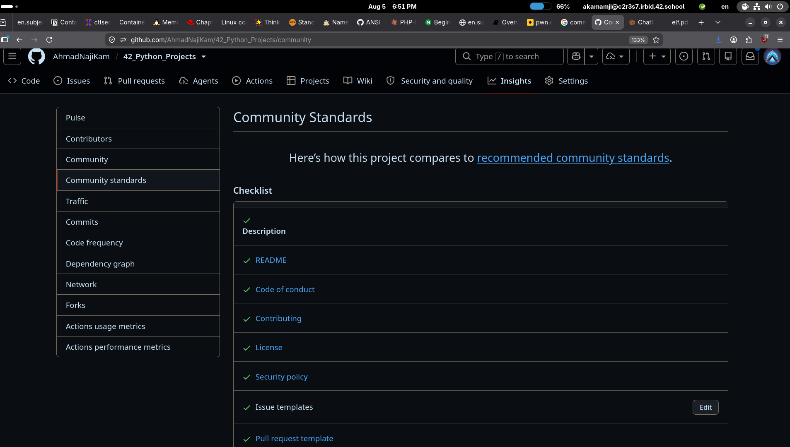

## Task1
I've chosen the AGPL because I don't want anyone to use my software or any modified version in a profitable manner without sharing the knowledge with the other people.
The task is done in this [commit](https://github.com/AhmadNajiKam/42_Python_Projects/commit/cd76347c6e6ffb442e33a1ed54c17509e0037e27).

## Task2
This is the picture of my 42_Python_Projects community profile 

## Task3
You can see the solution in this [commit](https://github.com/AhmadNajiKam/42_Python_Projects/commit/b065ca32835095337dcf9cca76ba7359e82895d1)

## Task4
Here I added the governance info related to my project [commit](https://github.com/AhmadNajiKam/42_Python_Projects/commit/081a8fd66842bc080537873b2024fe11f8025f08)

## Task5
I figured that one of the repos I use doesn't have code of conduct added to it so I added one in this pr and hopefully it get accepted [PR Link](https://github.com/woodpecker-ci/woodpecker/pull/6959)
